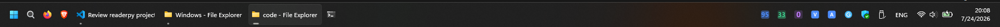

# WinThings

Three independent Windows 11 tray utilities that share a look, a settings pattern
and a config layout. Each runs as its own background process with its own tray
icon; none of them touch Explorer, the Start menu or the real taskbar.

| App | What it does | Default hotkey |
|---|---|---|
| [clipboard](clipboard/) | Searchable clipboard history that survives reboot | `Ctrl+Shift+V` |
| [reader](reader/) | Reads the selected text aloud with a Piper neural voice | `Ctrl+Shift+A` |
| [monitors](monitors/) | CPU/RAM/GPU/network readouts in the notification area | — |

[dock/](dock/) is retired — a floating always-on-top panel, superseded by
`monitors` plus native taskbar settings (see below). Still runnable with
`python dock\app.py` if you want it back.

## Using the real taskbar instead of a custom one

Windows 11 removed deskbands, so nothing can add content to the taskbar strip
without shell-level patching of Explorer, which is out of scope here. What the
dock did can be had from the real taskbar plus the notification area:

| Dock feature | Native equivalent |
| --- | --- |
| Pinned + running app icons | The taskbar already does this |
| Windows expanded as visible chips | Settings -> Personalisation -> Taskbar -> Taskbar behaviours -> **Combine taskbar buttons and hide labels: Never** (registry `HKCU\...\Explorer\Advanced\TaskbarGlomLevel = 2`, needs an Explorer restart) |
| CPU/RAM/GPU/network readouts | [monitors](monitors/) tray icons |

To go back to grouped, unlabelled taskbar buttons, set `TaskbarGlomLevel` to `0`
and restart Explorer.

---

## Screenshots

| | |
|---|---|
|  | The real taskbar doing the whole job: each window its own labelled button on the left, CPU/RAM/GPU readouts in the tray on the right next to the clipboard and reader icons. |
|  | Clipboard popup filtering live as you type. |
|  | Reader settings, with the live status dot reporting the bound hotkey. |

Also in [screenshots/](screenshots/): `tray-icons.png` (icon rendering at 64px
and at the 16px Windows displays), `clipboard-popup.png`,
`clipboard-settings.png`, and `dock-*.png` from the retired dock.

---

## Setup

Python 3.12 lives at `C:\Users\c\AppData\Local\Programs\Python\Python312\` and is
**not on PATH**, so every command below uses the full interpreter path.

```
C:\Users\c\AppData\Local\Programs\Python\Python312\python.exe -m pip install -r requirements.txt
```

The reader needs `piper.exe` and at least one voice. Both are **already installed**
here: Piper 2023.11.14 in `reader\piper\`, and the `en_US-ryan-medium` voice (US
male, medium quality) in `reader\voices\`. They are gitignored, so a fresh clone
has to fetch them again — see [reader/README.md](reader/README.md).

For the dock to make sense, auto-hide the real taskbar:
Settings → Personalisation → Taskbar → Taskbar behaviours → Automatically hide.

---

## Running

Each app is standalone:

```
python.exe clipboard\app.py
python.exe reader\app.py
python.exe dock\app.py
```

Or drive all three with the launcher:

```
python.exe winthings.py              start everything not already running
python.exe winthings.py dock reader  start just those
python.exe winthings.py --status     what is running
python.exe winthings.py --stop       stop everything
python.exe winthings.py --console    start with consoles attached, to see tracebacks
```

Use `pythonw.exe` instead of `python.exe` to avoid a console window. Each app holds a
named mutex, so launching one twice is a no-op rather than a duplicate tray icon.
"Start with Windows" in any settings window registers that app under the per-user
`HKCU\...\CurrentVersion\Run` key.

---

## Layout

```
common/       shared by all three - treat as the suite's API
  config.py     JSON config: defaults, atomic writes, change subscriptions
  ui.py         SettingsWindow base + the row widgets + cross-thread pump()
  theme.py      one palette and metric colours
  tray.py       pystray wrapper, icons drawn at runtime
  hotkey.py     global hotkey binding, capture, normalisation
  autostart.py  start-with-Windows via the Run key
  singleton.py  named-mutex single-instance guard
  paths.py      %APPDATA%\WinThings\<app>\
clipboard/    app.py store.py winclip.py popup.py settings.py
reader/       app.py speech.py engine.py selection.py overlay.py ipc.py settings.py
monitors/     app.py metrics.py trayicons.py settings.py
dock/         retired floating panel - kept, not started by the launcher
winthings.py  launcher
```

Config and data live in `%APPDATA%\WinThings\<app>\` — `config.json`, plus
`history.db` for the clipboard. Deleting that folder resets an app to defaults.

Tk insists on owning the main thread, so each app keeps one long-lived root, runs
its tray icon and pollers on daemon threads, and marshals work back with
`common.ui.call_on_ui_thread()`. Anything with a long-lived non-settings root must
call `common.ui.pump(root)` once.

---

## Known limitations

These are real constraints of running unelevated Python on Windows, not
oversights — they are documented per-app in more detail.

**All apps.** The global hotkey hook is blind while an elevated window has focus;
Windows blocks lower-integrity processes from hooking higher ones. Running an app
as administrator fixes it for that app.

**Clipboard.** The sensitive-app exclude list works two ways: it honours the
`ExcludeClipboardContentFromMonitorProcessing` and `CanIncludeInClipboardHistory`
clipboard formats that real password managers set — the correct mechanism — and
additionally skips a configurable list of process names. The name list races the
clipboard event and cannot see elevated processes, so treat it as convenience,
not a security boundary. Auto-paste cannot focus elevated windows. Search covers
the first 4096 characters of an entry.

**Reader.** Selection capture works by synthesising `Ctrl+C` and restoring the
previous clipboard afterwards; that restore is **text-only**, so an image or file
list on the clipboard is lost when the hotkey fires. Reading mode has to fully
synthesise before it can start highlighting, because Piper emits no word-level
timing.

**Monitors.** Windows renders tray icons at 16x16; these are drawn at 64x64 and
downsampled, so two digits are crisp and three (`100`, `3.2M`) are readable but
tight — the hover tooltip is the precise source. Tray icon order is Windows'
decision, not the app's.

**GPU metric.** On an Optimus laptop the discrete GPU parks itself and NVML then
returns `NVML_ERROR_UNKNOWN` for every query after the first — measured here as
1 success in 25 one-second polls. Recovery means tearing the NVML session down
and re-initialising it, which costs ~575 ms, so it happens at most once every 10
seconds — the GPU number therefore refreshes far more slowly than CPU, RAM and
network. A parked GPU is genuinely idle, so a held 0% is accurate, but behaviour
under sustained GPU load is untested.

On machines with no NVIDIA GPU or no working NVML, the metric hides itself.
