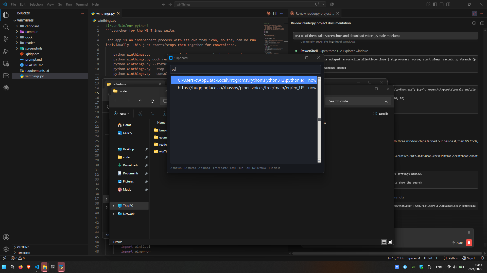
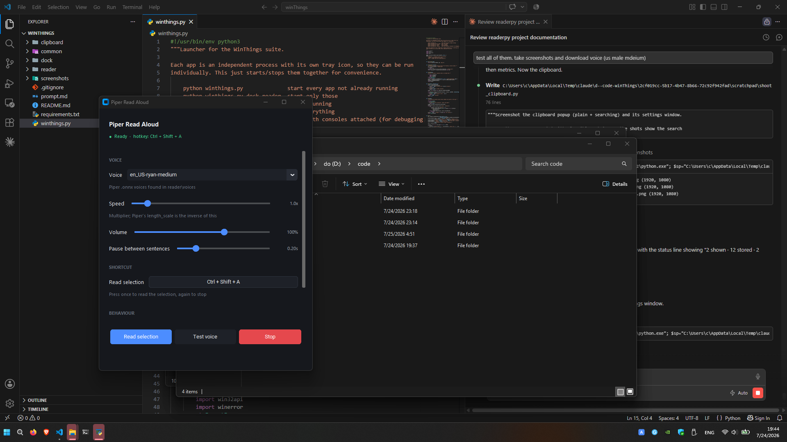

# WinThings

Two independent Windows 11 tray utilities that share a look, a settings pattern
and a config layout. Each runs as its own background process with its own tray
icon; neither touches Explorer, the Start menu or the taskbar.

| App | What it does | Default hotkey |
|---|---|---|
| [clipboard](clipboard/) | Searchable clipboard history that survives reboot | `Ctrl+Shift+V` |
| [reader](reader/) | Reads the selected text aloud with a Piper neural voice | `Ctrl+Shift+A` |

Both start with Windows via `HKCU\...\Run` (`WinThingsClipboard`,
`WinThingsReader`), toggleable from each settings window.

There is no system-monitor or dock app. Earlier versions had a floating dock
panel and a set of CPU/RAM/GPU tray readouts; both were removed as unwanted. They
remain in git history at commit `c094aba` (`git checkout c094aba -- dock monitors`)
if anyone ever wants them back.

---

## Screenshots

| | |
|---|---|
|  | Clipboard popup filtering live as you type. |
|  | Reader settings, with the live status dot reporting the bound hotkey. |

Also in [screenshots/](screenshots/): `clipboard-popup.png`,
`clipboard-settings.png`.

---

## Setup

Python 3.12 lives at `C:\Users\c\AppData\Local\Programs\Python\Python312\` and is
**not on PATH**, so every command below uses the full interpreter path.

```
C:\Users\c\AppData\Local\Programs\Python\Python312\python.exe -m pip install -r requirements.txt
```

The reader needs `piper.exe` and at least one voice. Both are **already installed**
here: Piper 2023.11.14 in `reader\piper\`, and the `en_US-ryan-medium` voice (US
male, medium quality) in `reader\voices\`. They are gitignored, so a fresh clone
has to fetch them again — see [reader/README.md](reader/README.md).

---

## Running

Each app is standalone:

```
python.exe clipboard\app.py
python.exe reader\app.py
```

Or drive both with the launcher:

```
python.exe winthings.py              start everything not already running
python.exe winthings.py reader       start just that one
python.exe winthings.py --status     what is running
python.exe winthings.py --stop       stop everything
python.exe winthings.py --console    start with consoles attached, to see tracebacks
```

Use `pythonw.exe` instead of `python.exe` to avoid a console window. Each app holds a
named mutex, so launching one twice is a no-op rather than a duplicate tray icon.
"Start with Windows" in any settings window registers that app under the per-user
`HKCU\...\CurrentVersion\Run` key.

---

## Layout

```
common/       shared by both apps - treat as the suite's API
  config.py     JSON config: defaults, atomic writes, change subscriptions
  ui.py         SettingsWindow base + the row widgets + cross-thread pump()
  theme.py      one palette, fonts and metrics
  tray.py       pystray wrapper, icons drawn at runtime
  hotkey.py     the public hotkey surface: normalise, display, record
  winhotkey.py  RegisterHotKey implementation - no keyboard hook
  keysend.py    SendInput key synthesis + stuck-modifier release
  autostart.py  start-with-Windows via the Run key
  singleton.py  named-mutex single-instance guard
  paths.py      %APPDATA%\WinThings\<app>\
clipboard/    app.py store.py winclip.py popup.py settings.py
reader/       app.py speech.py engine.py selection.py overlay.py ipc.py settings.py
winthings.py  launcher
```

Config and data live in `%APPDATA%\WinThings\<app>\` — `config.json`, plus
`history.db` for the clipboard. Deleting that folder resets an app to defaults.

Tk insists on owning the main thread, so each app keeps one long-lived root, runs
its tray icon and pollers on daemon threads, and marshals work back with
`common.ui.call_on_ui_thread()`. Anything with a long-lived non-settings root must
call `common.ui.pump(root)` once.

---

## Known limitations

These are real constraints of running unelevated Python on Windows, not
oversights — they are documented per-app in more detail.

**Both apps.** Global hotkeys go through `RegisterHotKey`, so each combination has
exactly one owner system-wide. If something else already owns yours, the bind
fails and the settings window says so instead of the hotkey silently doing
nothing — measured on this machine, `Win+Shift+A` is already taken by another
application. A hotkey also will not fire while an elevated window has focus,
unless the app is elevated too.

No app in this suite installs a keyboard hook. That is deliberate: the earlier
implementation used the `keyboard` package's `suppress=True`, which hooks
`WH_KEYBOARD_LL` and — because it cannot know on the Ctrl key-down whether a
hotkey is coming — blocks the modifier prefix and re-injects it once the next key
rules the combination out. Pressing Tab or Caps Lock after a modifier hits that
replay path, and with two apps each running their own block-and-replay state
machine, a dropped key-up left Ctrl or Shift stuck down. `RegisterHotKey` has the
OS match and consume the combination, so there is no hook, no suppression state
and nothing to replay. Synthetic keystrokes go through `SendInput`
([common/keysend.py](common/keysend.py)), which always releases what it pressed
and force-releases any modifier left held.

**Clipboard.** The sensitive-app exclude list works two ways: it honours the
`ExcludeClipboardContentFromMonitorProcessing` and `CanIncludeInClipboardHistory`
clipboard formats that real password managers set — the correct mechanism — and
additionally skips a configurable list of process names. The name list races the
clipboard event and cannot see elevated processes, so treat it as convenience,
not a security boundary. Auto-paste cannot focus elevated windows. Search covers
the first 4096 characters of an entry.

**Reader.** The selection is read through UI Automation where the app supports it
(browsers, Notepad, VS Code, Windows Terminal — see
[reader/README.md](reader/README.md#how-the-selection-is-read)), with no clipboard
involved. Elsewhere it falls back to synthesising `Ctrl+C` and restoring the
previous clipboard afterwards; that restore is **text-only**, so an image or file
list on the clipboard is lost when the fallback runs. Reading mode has to fully
synthesise before it can start highlighting, because Piper emits no word-level
timing.
